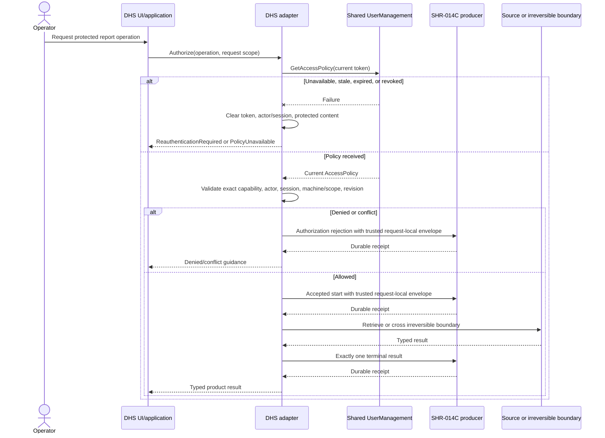
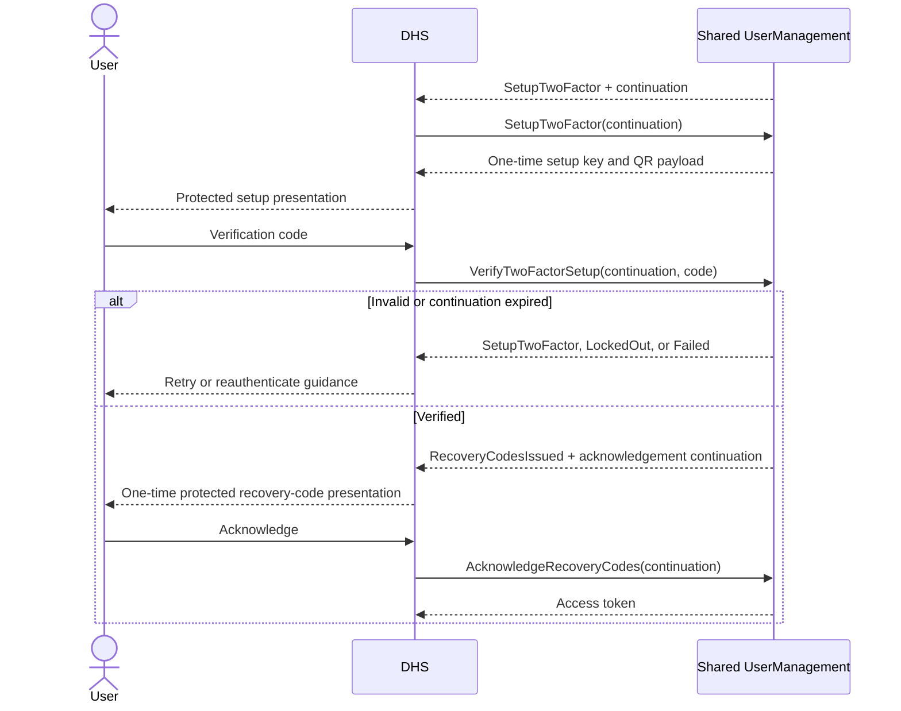
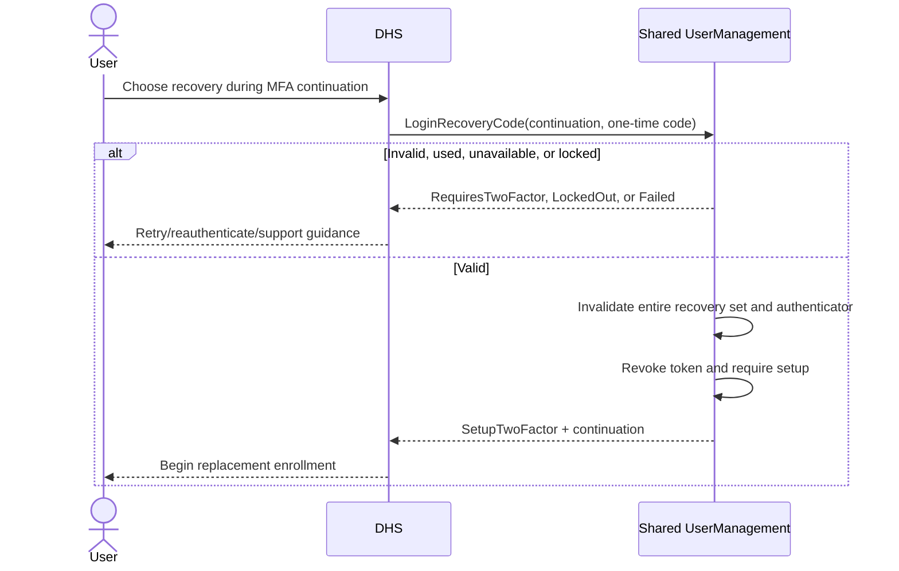
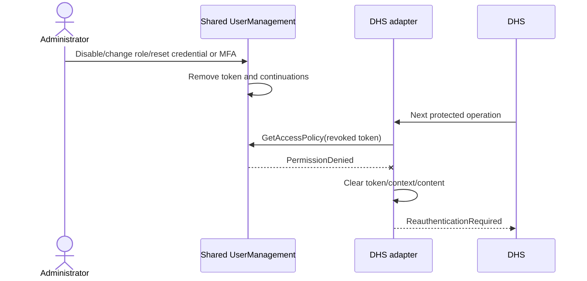
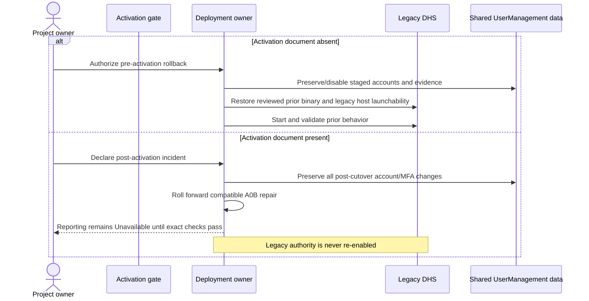

# Authorization migration sequence diagrams

In every diagram, `DHS adapter` means the A0B shared authorization adapter. `UM` means shared
Services/UserManagement `985f19b`. The legacy identity host is never a participant after activation.

## Login

```mermaid
sequenceDiagram
    actor Operator
    participant DHS
    participant A as DHS adapter
    participant UM as Shared UserManagement
    Operator->>DHS: Submit username and password
    DHS->>A: Login(request)
    A->>UM: Login(request)
    alt Invalid, disabled, or locked
        UM-->>A: Closed LoginResult; no token
        A-->>DHS: Safe denied/reauthenticate guidance
    else Password reset required
        UM-->>A: ResetCredentials + 5-minute continuation
        A-->>DHS: Credential reset flow
    else MFA enforcement on and setup required
        UM-->>A: SetupTwoFactor + 5-minute continuation
        A-->>DHS: MFA setup flow
    else MFA enforcement on and enrolled
        UM-->>A: RequiresTwoFactor + 5-minute continuation
        A-->>DHS: MFA verification/recovery flow
    else Successful password-only or completed MFA
        UM-->>A: Service-bound access token
        A->>UM: GetAccessPolicy(same token)
        UM-->>A: Current policy
        A->>A: Validate one ActorUserId; derive SessionId
        A-->>DHS: Ready session projection
    end
```
## Operation authorization and SHR-014C context



## MFA setup and verification



## Authorized MFA disable/reset

```mermaid
sequenceDiagram
    actor Administrator
    participant DHS
    participant UM as Shared UserManagement
    Administrator->>DHS: Disable/reset target MFA
    DHS->>UM: GetAccessPolicy(admin token)
    UM-->>DHS: Current administrator policy
    DHS->>UM: DisableTwoFactor(target, admin token)
    UM->>UM: Validate target scope; clear protected MFA/recovery state
    UM->>UM: Revoke target token and continuations; require setup
    UM-->>DHS: Success
    DHS-->>Administrator: Completed; target must follow global policy at next login
```

## Authorized password reset with optional MFA reset

```mermaid
sequenceDiagram
    actor Administrator
    participant DHS
    participant UM as Shared UserManagement
    Administrator->>DHS: Reset target credential; choose MFA reset explicitly
    DHS->>UM: ResetPassword(target, temporary credential, admin token, resetMfa)
    UM->>UM: Validate administrator and target scope
    UM->>UM: Replace credential; force next-login reset; unlock; revoke token/continuations
    opt resetMfa is true
        UM->>UM: Clear authenticator/recovery state; require setup
    end
    UM-->>DHS: Success
    DHS-->>Administrator: Completed with safe out-of-band handoff instruction
```

## MFA recovery



## Cutover

```mermaid
sequenceDiagram
    actor Owner as Project owner
    participant Legacy as Legacy DHS
    participant Tool as Migration/reconciliation tool
    participant UM as Shared UserManagement
    participant Deploy as Deployment owner
    participant NewDHS as A0B DHS
    Owner->>Legacy: Enter maintenance window; stop DHS
    Deploy->>Legacy: Disable legacy host and old-binary launchability
    Tool->>Legacy: Read frozen store; hash and inventory
    Tool->>UM: Controlled reprovisioning through authenticated APIs
    Tool->>UM: Stop/start; second read-only reconciliation
    UM-->>Tool: SERVING; zero sessions after restart
    Tool-->>Owner: 100% thresholds and hash-bound manifests
    alt Any threshold fails
        Owner-->>Deploy: Do not activate; execute pre-activation rollback
    else All thresholds pass
        Deploy->>NewDHS: Install exact reviewed A0B binary and Services gitlink
        Deploy->>Deploy: Atomically install v1 activation document
        Deploy->>UM: Start and verify Self=SERVING
        Deploy->>NewDHS: Start
        NewDHS-->>Owner: Disabled until login; then request-local Ready
    end
```

## Offline or policy-service loss

```mermaid
sequenceDiagram
    actor Operator
    participant DHS
    participant A as DHS adapter
    participant UM as Shared UserManagement
    Operator->>DHS: Request/report content is open
    DHS->>A: Authorize exact operation
    A->>UM: GetAccessPolicy(token)
    UM--xA: Unavailable
    A->>A: Set Unavailable; discard policy, token context, and protected content
    A-->>DHS: PolicyUnavailable / retry-when-ready
    DHS-->>Operator: Neutral persistent guidance; unrelated workflows remain
```

## Shared service restart

```mermaid
sequenceDiagram
    participant UM as Shared UserManagement
    participant A as DHS adapter
    participant DHS
    UM-->>A: Health leaves SERVING
    A->>A: Set Unavailable; clear protected content/context
    UM->>UM: Restart; token and continuation caches are empty
    UM-->>A: Health returns SERVING
    A->>UM: GetAccessPolicy(old token)
    UM--xA: PermissionDenied
    A->>A: Discard old token
    A-->>DHS: ReauthenticationRequired
```

## Revocation



## Logout

```mermaid
sequenceDiagram
    actor User
    participant DHS
    participant A as DHS adapter
    participant UM as Shared UserManagement
    User->>DHS: Logout
    DHS->>A: End session
    A->>UM: CancelAccessToken(token)
    alt Service accepts revocation
        UM-->>A: Success
    else Service unavailable or already invalid
        UM--xA: Failure
    end
    A->>A: Always erase local token/context/policy/content
    A-->>DHS: Logged out locally; reporting disabled
```

## Rollback


