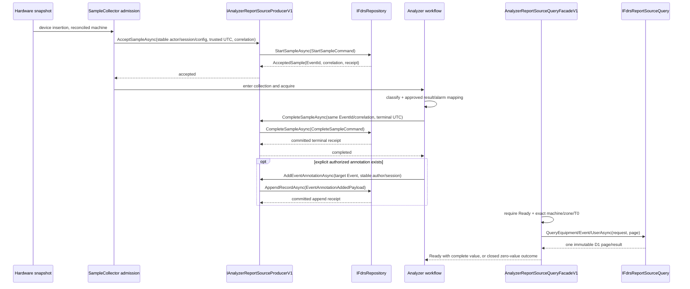
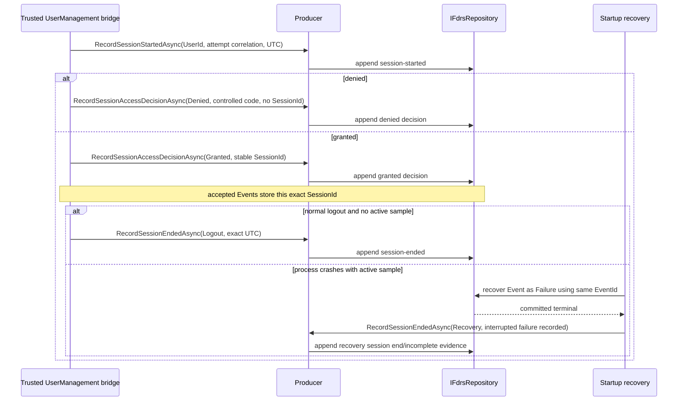
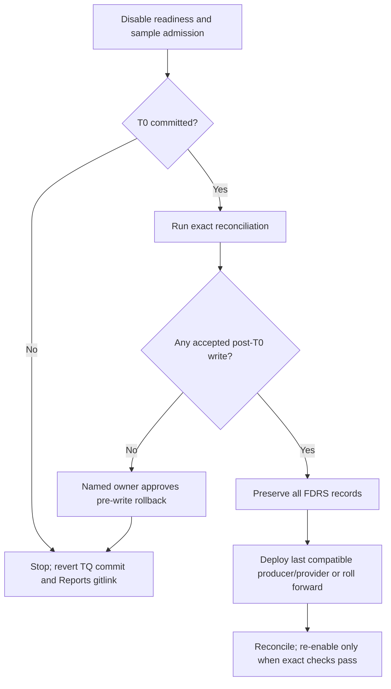

# TQ-011A sequence diagrams

## 1. Accepted sample, terminal commit, and snapshot query



The legacy scan save is outside the report atomicity boundary. If it yields a safe opaque retained-data reference in time, that reference may be included in terminal completion; it cannot determine Event identity or report visibility.

## 2. Cutover and activation

```mermaid
sequenceDiagram
    participant O as Named release owner
    participant H as Host/analyzer
    participant G as Readiness gate
    participant R as FDRS repository
    participant D2 as Published D2 provider

    O->>H: deploy exact approved product + gitlinks, disabled
    H->>G: Disabled
    O->>H: quiesce sample admission and report requests
    H->>R: initialize/capability check
    H->>H: validate D1/D2 SHA, machine hash, zone rules, clock, session bridge, alarm map, config
    H->>R: prove no active sample/session and zero legacy/import state
    alt any check fails
        H->>G: keep Disabled; closed zero-value outcome
    else all checks pass
        H->>R: commit activation record(T0, versions, machine, zone fingerprint, config)
        H->>G: WritersEnabled, QueriesDisabled
        H->>R: deterministic producer/reconciliation probes
        H->>D2: D1 conformance query probes
        alt exact reconciliation and probes pass
            H->>G: Ready
        else mismatch/gap/unknown
            H->>G: Disabled
        end
    end
```

There is no stage in which queries are enabled before compatible writers or in which legacy data is consulted.

## 3. Ambiguous acceptance and process restart

```mermaid
sequenceDiagram
    participant SC as Sample admission
    participant P as Producer
    participant R as IFdrsRepository
    participant S as Startup/reconciliation
    participant G as Readiness gate

    SC->>P: AcceptSampleAsync(correlation C)
    P->>R: StartSampleAsync(C)
    R--xP: commit acknowledgement ambiguous
    P-->>SC: acceptance unconfirmed; do not collect
    P->>G: disable new starts and queries
    Note over P,R: never create a replacement correlation or ID
    S->>G: Disabled on restart
    S->>R: Initialize + resolve deterministic receipt C
    alt start committed and Event open
        S->>R: RecoverInterruptedSampleAsync(same machine/Event -> Failure)
    else start not committed
        S->>R: prove no Event/receipt for C
    else resolution unavailable/conflicting
        S->>G: SourceUnavailable/SourceGap
    end
    S->>R: reconcile high-water, terminals, receipts, session links
    alt zero discrepancies
        S->>G: enable after remaining startup gates
    else any discrepancy
        S->>G: remain Disabled
    end
```

## 4. Session lifecycle and crash ordering



No username, token, time-overlap join, or fabricated end time is used.

## 5. Rollback decision



After a post-`T0` write, rollback never deletes/reinterprets records and never returns to legacy report reads.
