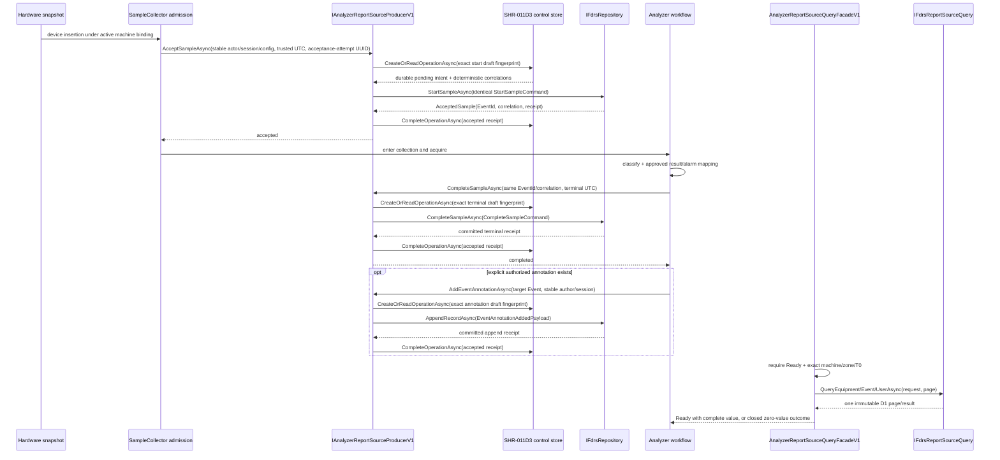
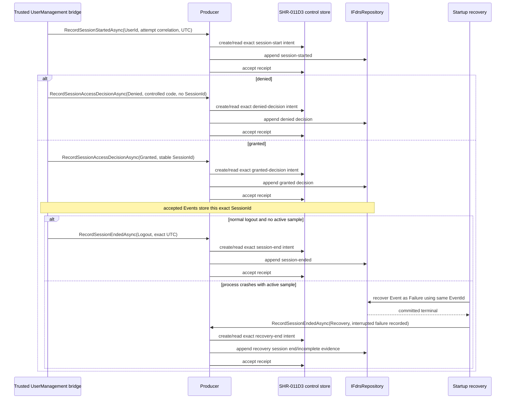
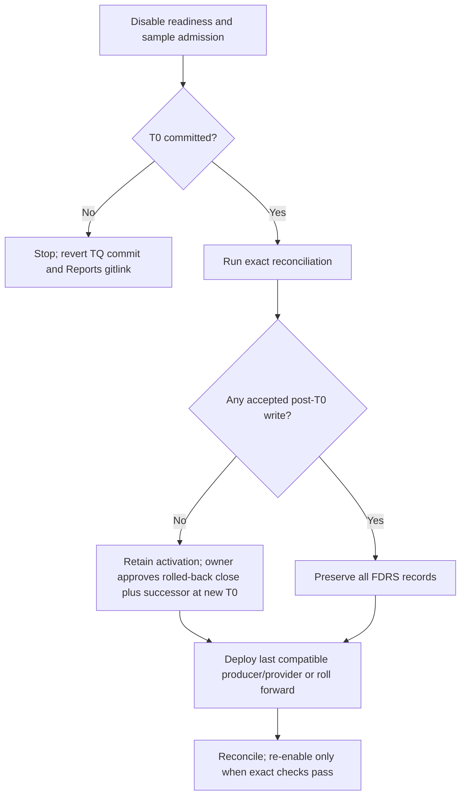

# TQ-011A sequence diagrams

## 1. Accepted sample, terminal commit, and snapshot query



The legacy scan save is outside the report atomicity boundary. If it yields a safe opaque retained-data reference in time, that reference may be included in terminal completion; it cannot determine Event identity or report visibility.

## 2. Cutover and activation

```mermaid
sequenceDiagram
    participant O as Named release owner
    participant H as Host/analyzer
    participant G as Readiness gate
    participant C as SHR-011D3 control store
    participant HW as Hardware client
    participant R as FDRS repository
    participant D2 as Published D2 provider

    O->>H: deploy exact approved product + gitlinks, disabled
    H->>G: Disabled
    O->>H: quiesce sample admission and report requests
    H->>H: capture startup UUID + trusted occurrence; construct source; no draft
    H->>C: initialize schema/capability
    H->>R: initialize schema/capability
    H->>HW: await health Serving, then subsequent connected DevicesChanged snapshot
    H->>H: validate D1/D2/D3 SHA, machine hash, zone bytes/hash, clock, session, alarm, config
    H->>C: prove no activation/pending operation state
    H->>R: prove no active sample/session and zero preactivation/import state
    alt any check fails
        H->>G: keep Disabled; closed zero-value outcome
    else all checks pass
        H->>C: ActivateAsync(binding); atomically re-prove zero state + create generation 1/pointer; commit defines T0
        H->>C: journal restart-start intent
        H->>R: append restart-start
        H->>C: accept restart-start receipt
        H->>G: WritersEnabled, QueriesDisabled
        H->>R: deterministic producer/reconciliation probes
        H->>D2: D1 conformance query probes
        alt exact reconciliation and probes pass
            H->>C: journal restart-completion intent
            H->>R: append successful restart completion
            H->>C: accept completion receipt
            H->>G: Ready
        else mismatch/gap/unknown
            H->>G: Disabled
        end
    end
```

There is no stage in which queries are enabled before compatible writers or in which legacy data is consulted.

## 3. Ambiguous acceptance and process restart

```mermaid
sequenceDiagram
    participant SC as Sample admission
    participant P as Producer
    participant C as SHR-011D3 control store
    participant R as IFdrsRepository
    participant S as Startup/reconciliation
    participant G as Readiness gate

    SC->>P: AcceptSampleAsync(logical attempt A)
    P->>C: commit intent A + exact draft; derive correlation C
    P->>R: StartSampleAsync(C)
    R--xP: commit acknowledgement ambiguous
    P-->>SC: acceptance unconfirmed; do not collect
    P->>G: disable new starts and queries
    Note over P,R: never create a replacement correlation or ID
    S->>G: Disabled on restart
    S->>C: Initialize + read pending intent C
    S->>R: Initialize + resolve deterministic receipt C with stored draft
    alt start committed and Event open
        S->>C: mark start accepted; journal recovery intent
        S->>R: RecoverInterruptedSampleAsync(same machine/Event -> Failure)
    else start not committed
        S->>R: prove no Event/receipt for C
    else resolution unavailable/conflicting
        S->>G: SourceUnavailable/SourceGap
    end
    S->>C: persist resolved receipts
    S->>R: reconcile activation interval, high-water, terminals, receipts, session links
    alt zero discrepancies
        S->>G: enable after remaining startup gates
    else any discrepancy
        S->>G: remain Disabled
    end
```

## 4. Session lifecycle and crash ordering



No username, token, time-overlap join, or fabricated end time is used.

## 5. Frozen startup/restart order

```mermaid
sequenceDiagram
    participant H as Host
    participant L as Reporting lifecycle
    participant C as SHR-011D3 control store
    participant R as IFdrsRepository
    participant HW as Existing hardware client
    participant D as Trusted dependencies
    participant G as Readiness

    H->>H: capture startup-attempt UUID + TimeProvider UTC
    H->>L: pass UUID/OccurredUtc
    L->>G: Disabled
    L->>L: construct authoritative SourceComponent
    L->>C: InitializeAsync
    L->>R: InitializeAsync
    L->>HW: subscribe DevicesChanged; await health Serving; await later connected snapshot
    L->>C: read/match active activation or owner-approved ActivateAsync
    L->>C: read pending operations
    loop each pending operation
        L->>R: resolve/retry identical stored draft
        L->>C: persist accepted receipt
    end
    L->>R: recover active Event as Failure
    L->>D: end owning session as recovery/incomplete
    L->>C: journal restart-start
    L->>R: append restart-start
    L->>D: await session/config/alarm/provider + algorithm warmup
    L->>L: reconcile and run conformance probes
    L->>C: journal restart completion
    L->>R: append completion; persist receipt
    L->>G: WritersEnabledQueriesDisabled, then Ready
```

No FDRS draft is constructed before storage initialization, authoritative source construction, trusted occurrence capture, machine observation, and activation binding. No new draft is admitted before pending-operation and sample/session recovery.

## 6. Rollback decision



After a post-`T0` write, rollback never deletes/reinterprets records and never returns to legacy report reads.
